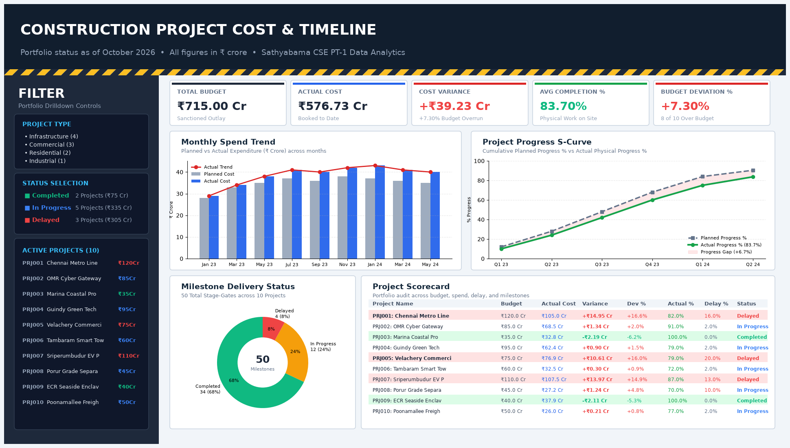

# Construction Project Cost & Timeline Governance Dashboard


A comprehensive Business Intelligence dashboard built with **Microsoft Power BI Desktop** to monitor capital expenditures, schedule progress, milestone stage-gates, and cost variances across 10 major civil infrastructure and commercial projects situated in the Chennai metropolitan area.

Developed as part of the **Periodic Test - 1 (PT-1) Data Analytics Laboratory** curriculum.

---

## 👤 Student Information
- **Student Name**: Shamith
- **Degree**: Bachelor of Engineering (B.E.)
- **Department**: Computer Science and Engineering (3rd Year)
- **Institution**: Sathyabama Institute of Science and Technology, Chennai - 600 119
- **GitHub**: [@shamith868](https://github.com/shamith868)
- **Email**: shamithneerugattu13209@gmail.com

---

## 📊 Executive Summary & Ground Truth Benchmarks

```
================================================================================================
TOTAL BUDGET          ACTUAL COST          COST VARIANCE        AVG COMPLETION %   BUDGET DEV %
₹715.00 Cr            ₹576.73 Cr           +₹39.23 Cr           83.70%             +7.30%
================================================================================================
```

- **Portfolio Capital**: **₹715.00 Crores** across 10 capital works.
- **Cost Variance**: **+₹39.23 Crores** net overrun (+7.30% Budget Deviation).
- **Physical Site Progress**: **83.70%** actual completion vs **90.40%** planned baseline (**+6.70% Progress Gap**).
- **Stage-Gate Delivery**: **68.00%** (34 of 50 milestones completed, 12 in progress, 4 delayed).
- **Overrun Concentration**: **99.2%** of cost overruns originate from just 3 projects: Chennai Metro Line 4 (+₹14.95 Cr), Sriperumbudur EV Plant (+₹13.97 Cr), and Velachery Commercial Mall (+₹10.61 Cr).

---

## 🖼️ Dashboard Preview



```
+----------------------------------------------------------------------------------------------------+
| [CONSTRUCTION PROJECT COST & TIMELINE DASHBOARD | SATHYABAMA CSE PT-1 DATA ANALYTICS]              |
+--------------------+--------------------+--------------------+--------------------+----------------+
| TOTAL BUDGET       | ACTUAL COST        | COST VARIANCE      | AVG COMPLETION %   | BUDGET DEV %   |
| ₹715.00 Cr         | ₹576.73 Cr         | +₹39.23 Cr         | 83.70%             | +7.30%         |
+--------------------+--------------------+--------------------+--------------------+----------------+
| FILTER SIDEBAR     | VISUAL 1: Monthly Spend Trend                    | VISUAL 3: Milestone Status     |
| - Project Type     | (Line & Clustered Column Combo Chart)            | (Donut Chart: 68% Completed)   |
| - Project Status   +--------------------------------------------------+--------------------------------+
| - Active Projects  | VISUAL 2: Project Progress S-Curve               | VISUAL 4: Project Scorecard    |
|   (List Table)     | (Planned % vs Actual % over Time)                | (Audit Matrix Table)           |
+--------------------+--------------------------------------------------+--------------------------------+
```

---

## 🏗️ Architecture & Data Model

The data model follows an optimized **Star Schema (1-to-Many `1:*`)** linking the primary lookup dimension table to periodic fact tables via `Project ID`:

```
                  +---------------------------+
                  |         Projects          |
                  |     (Dimension Table)     |
                  | PK: Project ID            |
                  +---------------------------+
                        |       |       |
             1-to-many  |       |       |  1-to-many
              (1 : *)   |       |       |   (1 : *)
         +--------------+       |       +---------------+
         |                      |                       |
         v                      v                       v
+------------------+ +--------------------+ +--------------------+
|   Project_Cost   | |  Project_Progress  | |     Milestones     |
|   (Fact Table)   | |    (Fact Table)    | |    (Fact Table)    |
| FK: Project ID   | | FK: Project ID     | | FK: Project ID     |
+------------------+ +--------------------+ +--------------------+
```

- **Cardinality**: `1-to-Many (1:*)`
- **Filter Direction**: `Single` (Filters propagate downward from `Projects` to fact tables)

---

## 📂 Repository Structure

```
├── Construction_Project_Cost_Timeline_Dashboard -2.pbix   # Completed Power BI Report File
├── Construction_Project_Cost_Timeline_Dashboard.pbix      # Base Power BI Template
├── Dashboard_Screenshot.png                               # High-Resolution Dashboard Preview Image
├── README.md                                              # Comprehensive Project Documentation
├── WHAT_I_HAVE_TO_DO.md                                   # Step-by-Step Manual Build Instructions
│
├── data/
│   ├── Cleaned_Data/                                      # Cleaned Production Datasets
│   │   ├── Construction_Project_Data.xlsx                 # Master Multi-Sheet Cleaned Excel File
│   │   ├── Projects.csv
│   │   ├── Project_Cost.csv
│   │   ├── Project_Progress.csv
│   │   └── Milestones.csv
│   └── Raw_Data/                                          # Raw Pre-ETL Uncleaned Datasets
│       ├── Construction_Project_Raw_Data.xlsx             # Raw Ingestion Multi-Sheet Excel File
│       ├── Raw_Projects.csv
│       ├── Raw_Project_Cost.csv
│       ├── Raw_Project_Progress.csv
│       └── Raw_Milestones.csv
│
├── dax/
│   └── DAX_Measures_Reference.md                          # Full DAX Formulas & Calculation Rationale
├── power_query/
│   └── Power_Query_M_Code.md                              # Advanced Editor M-Code & ETL Rules
├── dashboard/
│   └── Dashboard_Design_Guide.md                          # Visual Positioning, Hex Palette & Theme
└── docs/
    ├── PT1_Project_Report.md                              # 21-Section Academic College Submission Report
    ├── Presentation_Slides.md                             # 12-Slide Review Presentation Outline
    ├── Viva_Voce_QA.md                                    # 15 High-Probability Viva Voce Questions & Answers
    └── Project_Architecture_Workflow.md                   # Mermaid & Pipeline Architecture Diagrams
```

---

## 🔢 Core DAX Measures (`_Measures` Table)

| Measure | DAX Expression | Default Format | Benchmark |
|---|---|---|---|
| **Total Budget** | `SUM(Projects[Budget])` | Currency (₹) | ₹7,15,00,00,000 |
| **Planned Cost** | `SUM(Project_Cost[Planned Cost])` | Currency (₹) | ₹5,37,50,05,000 |
| **Actual Cost** | `SUM(Project_Cost[Actual Cost])` | Currency (₹) | ₹5,76,73,38,000 |
| **Cost Variance** | `[Actual Cost] - [Planned Cost]` | Currency (₹) | +₹39,23,33,000 |
| **Budget Deviation %** | `DIVIDE([Cost Variance], [Planned Cost], 0)` | Percentage (%) | +7.30% |
| **Project Completion %** | `MAX(Project_Progress[Actual Progress %])` | Percentage (%) | Project Specific |
| **Planned Progress %** | `MAX(Project_Progress[Planned Progress %])` | Percentage (%) | Project Specific |
| **Progress Gap (Delay %)**| `[Planned Progress %] - [Project Completion %]`| Percentage (%) | +6.70% (Avg) |
| **Avg Project Completion %** | `AVERAGEX(Projects, [Project Completion %])` | Percentage (%) | 83.70% |
| **Milestone Completion %** | `DIVIDE([Completed Milestones], [Total Milestones], 0)` | Percentage (%) | 68.00% |

---

## 📈 Project-by-Project Audit Findings

| ID | Project Name | Type | Budget | Actual Cost | Variance | Dev % | Actual Prog % | Delay % | MS Comp % | Status |
|---|---|---|---|---|---|---|---|---|---|---|
| **PRJ001** | Chennai Metro Line 4 | Infra | ₹120.0 Cr | ₹105.0 Cr | **+₹14.95 Cr** | **+16.61%** | 82.0% | 16.0% | 60.0% | Delayed |
| **PRJ002** | OMR Cyber Gateway | Commercial | ₹85.0 Cr | ₹68.5 Cr | +₹1.34 Cr | +2.00% | 91.0% | 2.0% | 60.0% | In Progress |
| **PRJ003** | Marina Promenade | Infra | ₹35.0 Cr | ₹32.8 Cr | **-₹2.19 Cr** | **-6.25%** | 100.0% | 0.0% | 100.0% | Completed |
| **PRJ004** | Guindy Green Tech | Commercial | ₹95.0 Cr | ₹62.4 Cr | +₹0.90 Cr | +1.47% | 79.0% | 2.0% | 60.0% | In Progress |
| **PRJ005** | Velachery Mall | Commercial | ₹75.0 Cr | ₹76.9 Cr | **+₹10.61 Cr** | **+16.00%** | 79.0% | 20.0% | 60.0% | Delayed |
| **PRJ006** | Tambaram Township | Residential | ₹60.0 Cr | ₹32.5 Cr | +₹0.30 Cr | +0.93% | 72.0% | 2.0% | 60.0% | In Progress |
| **PRJ007** | Sriperumbudur EV Plant| Industrial | ₹110.0 Cr | ₹107.5 Cr | **+₹13.97 Cr** | **+14.94%** | 87.0% | 13.0% | 60.0% | Delayed |
| **PRJ008** | Porur Grade Separator | Infra | ₹45.0 Cr | ₹27.2 Cr | +₹1.24 Cr | +4.77% | 70.0% | 10.0% | 60.0% | In Progress |
| **PRJ009** | ECR Seaside Enclave | Residential | ₹40.0 Cr | ₹37.9 Cr | **-₹2.11 Cr** | **-5.27%** | 100.0% | 0.0% | 100.0% | Completed |
| **PRJ010** | Poonamallee Freight Hub| Industrial | ₹50.0 Cr | ₹26.0 Cr | +₹0.21 Cr | +0.83% | 77.0% | 2.0% | 60.0% | In Progress |

---

## 💡 Key Actionable Insights & Recommendations

1. **Scope Freeze on Velachery Mall (`PRJ005`)**: Actual spend (₹76.9 Cr) already exceeds the sanctioned budget (₹75 Cr) at only 79% physical progress. Freeze tenant customization requests immediately.
2. **Crash Scheduling on Metro Line 4 (`PRJ001`)**: Deploy additional pier casting shuttering to recover Milestone `MLS004` (Viaduct Erection) before the monsoon season.
3. **Expedite Industrial Customs at EV Plant (`PRJ007`)**: Milestone `MLS034` (Conveyor Cells) and `MLS035` (Substation) are delayed due to equipment import backlogs.
4. **Codify Best Practices from `PRJ003` and `PRJ009`**: Both completed projects finished under budget (-6.25% and -5.27%), confirming that strict schedule adherence limits indirect site overheads.

---

## 🚀 How to Run the Dashboard

1. Install [Microsoft Power BI Desktop](https://powerbi.microsoft.com/desktop/).
2. Clone this repository:
   ```bash
   git clone https://github.com/shamith868/Construction-Project-Cost-Timeline-Dashboard.git
   ```
3. Open `Construction_Project_Cost_Timeline_Dashboard -2.pbix`.
4. If prompted to update data source paths, point to `data/Cleaned_Data/Construction_Project_Data.xlsx` and click **Apply Changes**.
