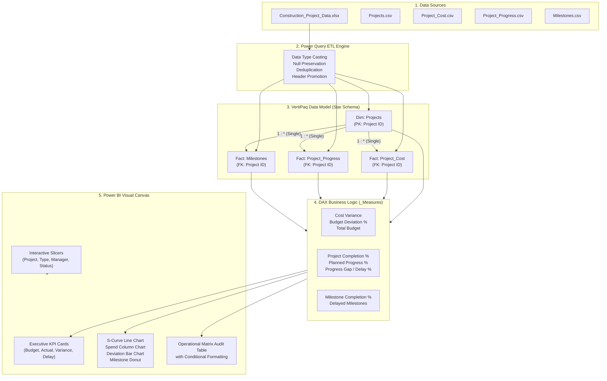

# Project Architecture & Workflow Specification

**Project**: Construction Project Cost & Timeline Dashboard  
**Academic Context**: 3rd-Year B.E. Computer Science Engineering, Sathyabama Institute of Science & Technology  

---

## 1. High-Level Data Pipeline Workflow

```
+-----------------------------------------------------------------------------+
|                            DATA GENERATION LAYER                            |
| Realistic Civil Construction Data (Projects, Spend, Progress, Milestones)   |
+-----------------------------------------------------------------------------+
                                      |
                                      v
+-----------------------------------------------------------------------------+
|                             DATA SOURCE LAYER                               |
| Construction_Project_Data.xlsx (Worksheets: Projects, Cost, Progress, MS)   |
+-----------------------------------------------------------------------------+
                                      |
                                      v
+-----------------------------------------------------------------------------+
|                           POWER QUERY ETL LAYER                             |
| - Header Promotion & Text Encoding                                          |
| - Data Type Casting (Int64 Currency, Float Percentages, Date)               |
| - Deduplication & Null Handling                                             |
+-----------------------------------------------------------------------------+
                                      |
                                      v
+-----------------------------------------------------------------------------+
|                           DATA MODELING LAYER                               |
| - Star Schema: Projects (1) ---> Cost, Progress, Milestones (*)             |
| - Primary Key / Foreign Key: [Project ID]                                   |
| - Single Cross-Filter Direction                                             |
+-----------------------------------------------------------------------------+
                                      |
                                      v
+-----------------------------------------------------------------------------+
|                            DAX MEASURES LAYER                               |
| Dedicated `_Measures` Table: Cost Variance, Budget Dev %, Delay %, KPIs     |
+-----------------------------------------------------------------------------+
                                      |
                                      v
+-----------------------------------------------------------------------------+
|                         POWER BI DASHBOARD LAYER                            |
| - KPI Cards | S-Curve Line Chart | Spend Column Chart | Deviation Bar       |
| - Milestone Donut | Slicers | Performance Matrix Table                     |
+-----------------------------------------------------------------------------+
                                      |
                                      v
+-----------------------------------------------------------------------------+
|                         DECISION SUPPORT LAYER                              |
| Actionable Project Management Insights & Engineering Interventions          |
+-----------------------------------------------------------------------------+
```

---

## 2. Mermaid Architecture Diagram



---

## 3. Relational Schema Data Dictionary

### Table: `Projects` (Dimension)
- `Project ID` [PK, Text]: Unique project identifier (`PRJ001` - `PRJ010`).
- `Project Name` [Text]: Descriptive title of construction development.
- `Location` [Text]: Geographic location in Chennai / Tamil Nadu.
- `Project Manager` [Text]: Supervising engineer in charge.
- `Start Date` [Date]: Site commencement date.
- `Planned End Date` [Date]: Contractual target handover date.
- `Budget` [Int64 / Currency]: Sanctioned capital expenditure in INR.
- `Project Type` [Text]: Category (`Infrastructure`, `Commercial`, `Residential`, `Industrial`).
- `Status` [Text]: Overall operational status (`Completed`, `In Progress`, `Delayed`).

### Table: `Project_Cost` (Fact)
- `Project ID` [FK, Text]: References `Projects[Project ID]`.
- `Date` [Date]: Monthly tracking date (`YYYY-MM-01`).
- `Planned Cost` [Int64 / Currency]: Monthly scheduled expenditure in INR.
- `Actual Cost` [Int64 / Currency]: Real booked expenditure on site in INR.

### Table: `Project_Progress` (Fact)
- `Project ID` [FK, Text]: References `Projects[Project ID]`.
- `Date` [Date]: Monthly tracking date (`YYYY-MM-01`).
- `Planned Progress %` [Float / Percentage]: Expected cumulative physical progress (0.00 - 1.00).
- `Actual Progress %` [Float / Percentage]: Real verified cumulative physical progress (0.00 - 1.00).

### Table: `Milestones` (Fact)
- `Milestone ID` [PK, Text]: Unique stage-gate code (`MLS001` - `MLS050`).
- `Project ID` [FK, Text]: References `Projects[Project ID]`.
- `Milestone Name` [Text]: Description of engineering stage-gate.
- `Planned Date` [Date]: Target completion date.
- `Actual Date` [Date / Null]: Actual achievement date (`null` if pending).
- `Status` [Text]: Stage-gate status (`Completed`, `In Progress`, `Delayed`).
